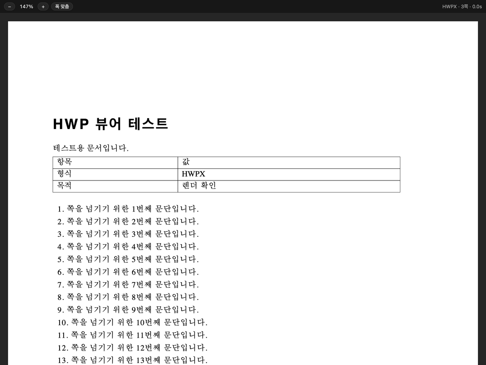

# HWP Viewer for Orca

[한국어](README.md) | **English**

A plugin that lets you open Hangul word processor files (`.hwp`, `.hwpx`) right inside [Orca](https://orca.dev).



## Features

- Open an `.hwp` or `.hwpx` file from the file explorer and it opens in an **HWP Preview** tab.
- Tables, borders, background colors, images and page breaks look the same as in the original document.
- A page opens fitted to the window height.
- Zoom with a trackpad pinch, Ctrl+wheel or the toolbar buttons, and press `쪽 맞춤` (fit page) or `폭 맞춤` (fit width) to go back.
- When an agent or another program changes the file, the view updates automatically.
- Password-protected documents ask for the password when opened. The password is not stored.
- Runs locally only. No network requests, no usage tracking.

Parsing and rendering are done by [kordoc](https://github.com/chrisryugj/kordoc) (MIT). It is bundled with the plugin, so there is nothing else to install.

## Installation

Works with the Orca **desktop app** `1.4.248` or later.

Search for `HWP Viewer` in Orca Settings → Plugins, or install it from the terminal:

```sh
orca plugin install chabinhwang/orca-hwp-viewer
```

### Why an approval prompt appears on install

kordoc uses Node.js modules such as `zlib` and `crypto`, so rendering has to run in a separate Orca Node worker. That makes this a `trusted-worker` plugin, and Orca asks you to confirm once before installing.

The worker only takes the contents of the open file and returns an SVG for each page. It requests no other capabilities, and all of its code is in this repository.

## Not supported yet

- Headers, footers and footnotes are not shown.
- Equations are drawn in simplified form in `.hwpx` and not shown in `.hwp`.
- OLE objects (embedded spreadsheets, charts) are not shown; the toolbar shows a warning instead.
- HWP 3.x files, distribution-locked HWPX and DRM-protected documents cannot be opened.
- If a font used in the document (such as HCR Batang) is not installed, a similar font is used instead.
- Editing is not supported yet.

If a document looks wrong, please let me know in the [issues](https://github.com/chabinhwang/orca-hwp-viewer/issues). When attaching a file, please use a copy with personal information removed.

## Code structure

| Path | Contents |
|---|---|
| `orca-plugin.json` | Manifest: `trusted-worker`, custom editor `hwp` (`contentKind: bytes`, `frame: isolated`) |
| `src/protocol.ts` | Requests between the editor and worker (`hwp.chunk`, `hwp.render`, `hwp.page`) and chunk sizes |
| `worker/` | Worker source. Joins the uploaded chunks, builds per-page SVG with kordoc `renderDocumentToScene` and caches it. Detects password-protected documents (`password.ts`) |
| `dist/worker.mjs` | Worker bundle built by `npm run build` (worker source + kordoc render path). The file Orca actually runs |
| `editor/` | Isolated-frame viewer: upload and lazy loading (`main.ts`), transport (`transport.ts`), SVG sanitizing (`svg.ts`), toolbar and pinch zoom (`view.ts`), zoom math (`zoom.ts`) |
| `scripts/build.mjs` | Builds the bundle and `THIRD_PARTY_NOTICES.txt`. With `--check`, only verifies the committed bundle matches the source |
| `scripts/make-fixtures.mjs` | Generates test HWPX files, including one locked with an open password (`locked.hwpx`) |

## License

[MIT](LICENSE). Licenses for kordoc and its dependencies bundled in `dist/worker.mjs` are collected in [THIRD_PARTY_NOTICES.txt](THIRD_PARTY_NOTICES.txt).
