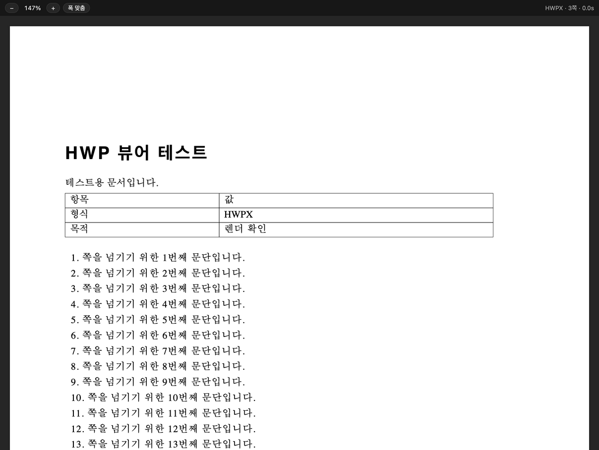

# HWP Viewer for Orca

[Orca](https://orca.dev)에서 한글 문서(`.hwp`, `.hwpx`)를 원본 쪽 배치 그대로 읽는 플러그인입니다.



- 파일 탐색기에서 `.hwp`·`.hwpx`를 열면 바로 **HWP Preview** 탭으로 보입니다.
- 표·테두리·배경색·그림·쪽 나눔을 한컴 문서의 조판 정보대로 그립니다.
- 확대·축소·폭 맞춤을 지원하고, 화면 가까이 온 쪽만 불러와 긴 문서도 가볍게 엽니다.
- 에이전트나 다른 프로그램이 파일을 바꾸면 자동으로 다시 그립니다.
- 모든 처리는 내 컴퓨터 안에서 끝납니다. 네트워크 요청이나 데이터 수집은 없습니다.

렌더 엔진은 [kordoc](https://github.com/chrisryugj/kordoc)(MIT)이고, 플러그인에 같이 묶여 있어 따로 설치할 것이 없습니다.

## 설치

Orca `1.4.248` 이상의 **데스크톱 앱**이 필요합니다. 브라우저 클라이언트에서는 Source 보기로 열립니다.

```sh
orca plugin install chabinhwang/orca-hwp-viewer
```

커뮤니티 카탈로그에 등록된 뒤에는 Orca 설정 → Plugins에서 `HWP Viewer`를 검색해 설치할 수도 있습니다.

### 왜 승인 창이 뜨나요

이 플러그인은 `trusted-worker`입니다. 한글 문서를 해석하는 kordoc이 Node.js 모듈(`zlib`, `crypto` 등)을 써서, 렌더를 Orca의 별도 Node 워커 프로세스에서 돌리기 때문입니다. 워커가 하는 일은 열린 파일의 바이트를 받아 쪽별 SVG를 돌려주는 것뿐입니다. 추가 권한(capability)은 하나도 요청하지 않습니다. 코드는 이 저장소에 모두 공개되어 있습니다.

## 알려진 한계

kordoc 렌더러의 한계를 그대로 따릅니다.

- 머리말·꼬리말·각주는 그리지 않습니다.
- 수식·OLE 개체는 그리지 않고 툴바에 경고로 표시합니다.
- HWP 3.x와 암호가 걸린 문서는 지원하지 않습니다.
- 문서에 지정된 글꼴(함초롬바탕 등)이 없으면 시스템의 비슷한 글꼴로 대신 그립니다.
- 읽기 전용입니다. 편집은 하지 않습니다.

잘못 그려지는 문서를 발견하면 [이슈](https://github.com/chabinhwang/orca-hwp-viewer/issues)에 알려 주세요. 문서를 첨부할 때는 개인정보를 지운 사본을 사용해 주세요.

## 구조

| 경로 | 역할 |
|---|---|
| `orca-plugin.json` | 매니페스트: `trusted-worker`, 커스텀 에디터 `hwp`(`contentKind: bytes`, `frame: isolated`) |
| `src/protocol.ts` | 에디터↔워커 요청 계약(`hwp.chunk`, `hwp.render`, `hwp.page`)과 조각 크기 |
| `worker/` | 워커 소스. 조각을 모아 kordoc `renderDocumentToScene`으로 쪽별 SVG를 만들고 캐시 |
| `dist/worker.mjs` | `npm run build`가 만드는 워커 번들(워커 소스 + kordoc 렌더 경로). Orca가 실행하는 파일 |
| `editor/` | 격리 프레임 뷰어: 업로드·지연 로드(`main.ts`), 전송(`transport.ts`), SVG 정리(`svg.ts`), 툴바(`view.ts`) |
| `scripts/build.mjs` | 번들과 `THIRD_PARTY_NOTICES.txt` 생성, `--check`로 커밋된 번들이 소스와 같은지 확인 |
| `scripts/make-fixtures.mjs` | 테스트용 HWPX를 kordoc으로 생성 |

### 구현 메모

- 에디터 프레임에서 워커로 보내는 메시지 한도는 문서에 나와 있지 않고, CLI(`orca plugin dev request`) 경로보다 작습니다. 그래서 파일은 base64 48,000자 조각으로 올리고, 쪽 SVG도 같은 크기로 나눠 받습니다. `too large` 오류가 나면 조각 크기를 절반씩 줄입니다.
- kordoc은 쪽마다 `#bin0`, `pgclip1` 같은 같은 id를 씁니다. 여러 쪽을 한 화면에 넣으면 그림 참조가 엇갈리므로 쪽마다 `p<쪽>-` 접두어를 붙입니다. 같은 단계에서 `script`·`foreignObject`·이벤트 속성·외부 링크를 지웁니다.
- Orca는 `.ts` 소스의 npm import를 허용하지 않습니다. 그래서 워커는 번들로 배포하고, 테스트도 번들을 대상으로 돌립니다.

## 개발

```sh
npm install
npm run build          # dist/worker.mjs, dist/worker.d.mts, THIRD_PARTY_NOTICES.txt
npm run typecheck
npm test               # 번들 최신 여부 확인 → 테스트 HWPX 생성 → orca plugin test
orca plugin check .
orca plugin dev watch .    # Orca에 개발 플러그인으로 올리고 로그·리로드 표시 (승인 필요)
orca plugin shot local.hwp-viewer --editor "$PWD/test/fixtures/generated/sample.hwpx" --out shot.png
```

- 워커나 kordoc 버전을 바꾸면 `npm run build` 결과(`dist/`, `THIRD_PARTY_NOTICES.txt`)도 함께 커밋해야 합니다. `npm test`는 번들이 소스와 다르면 실패합니다.
- 저장소에는 문서 파일을 두지 않습니다. 실제 HWP 5.x로 확인하려면 `test/fixtures/local/`(Git 제외)에 넣어 두세요. `npm test`가 그 폴더의 모든 문서를 렌더해 봅니다.

## 릴리스

1. `orca-plugin.json`의 `version`을 올리고 `npm run build && npm test`를 실행합니다.
2. 커밋한 뒤 `vX.Y.Z` 태그를 push합니다.
3. 저장소에 `orca-plugin` 토픽이 있으면 커뮤니티 카탈로그가 보통 1시간 안에 새 버전을 올립니다. 한 번 올라간 버전은 바꿀 수 없으므로 수정은 항상 새 버전으로 냅니다.

## 라이선스

[MIT](LICENSE). `dist/worker.mjs`에 묶인 kordoc과 그 의존성의 라이선스는 [THIRD_PARTY_NOTICES.txt](THIRD_PARTY_NOTICES.txt)에 있습니다.

---

**English.** An Orca custom editor that renders Hangul word processor documents (`.hwp` 5.x and `.hwpx`) with their original page layout, using the bundled [kordoc](https://github.com/chrisryugj/kordoc) renderer in a plugin worker. Read-only, fully local, no network access. Install with `orca plugin install chabinhwang/orca-hwp-viewer` (Orca desktop `>= 1.4.248`).
